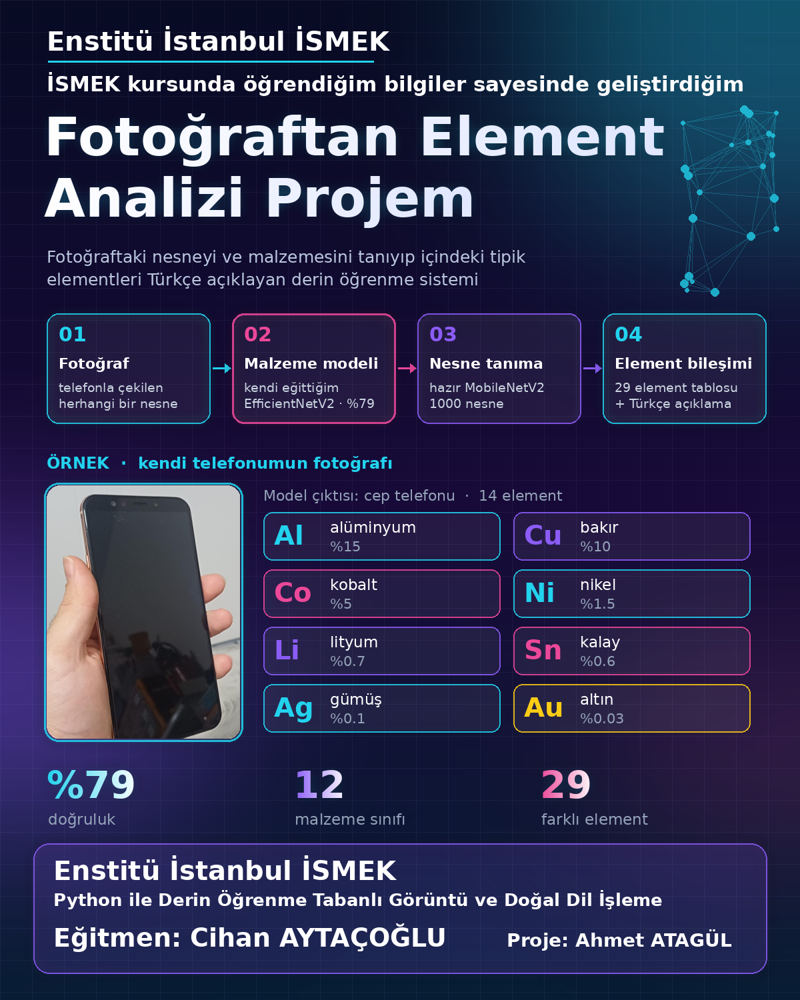
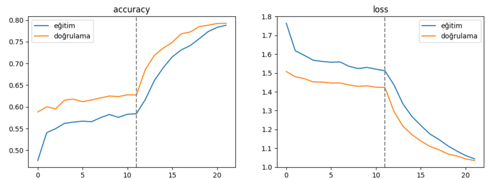
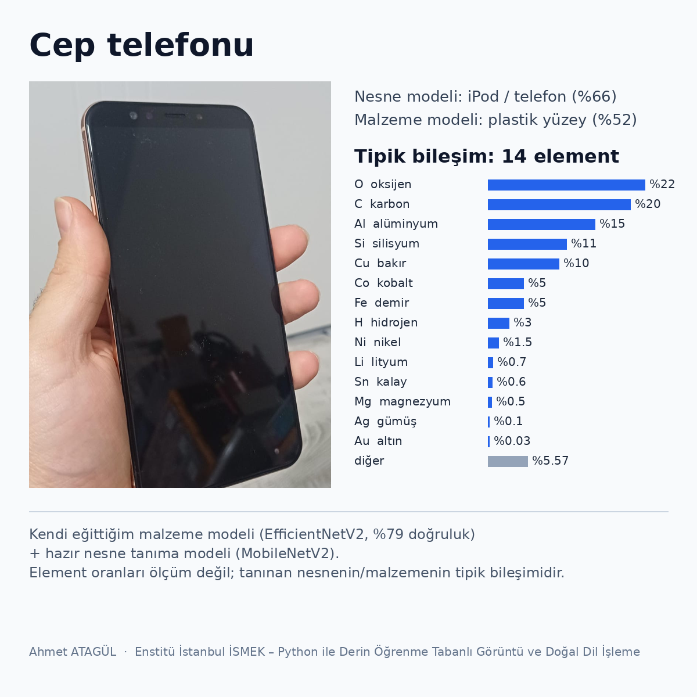
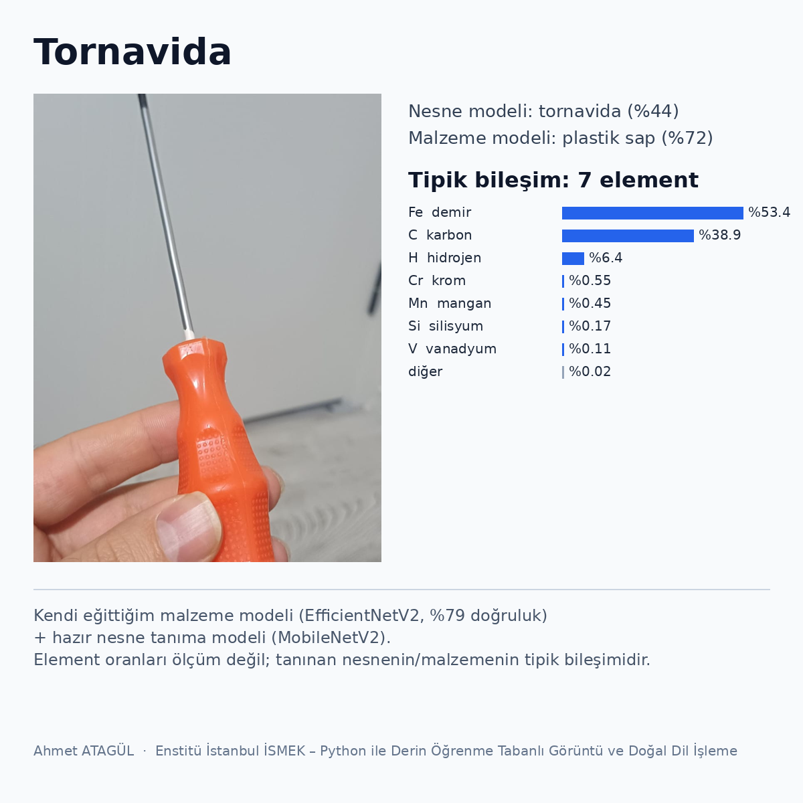
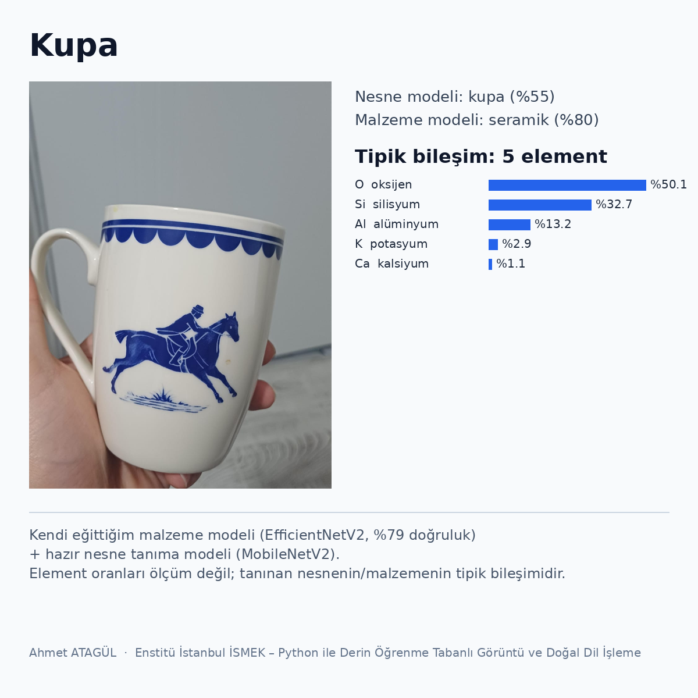

# Fotoğraftan Element Analizi

Bir fotoğraftaki nesnenin malzemesini tanıyıp içindeki **tipik element bileşimini** Türkçe açıklayan derin öğrenme projesi.

Enstitü İstanbul İSMEK **"Python ile Derin Öğrenme Tabanlı Görüntü ve Doğal Dil İşleme"** programı kapsamında geliştirdim.
Eğitmen: **Cihan AYTAÇOĞLU**

## Nasıl çalışıyor?

1. **Fotoğraf**: telefonla çekilen herhangi bir nesne
2. **Malzeme modeli** (kendi eğittiğim): EfficientNetV2B0 ile transfer learning, 12 malzeme sınıfı
3. **Nesne tanıma** (hazır model): ImageNet'te eğitilmiş MobileNetV2, 1000 nesne
4. **Element bileşimi**: nesne tanınırsa nesneye özel, tanınmazsa malzemeye göre tipik bileşim tablosu ve Türkçe açıklama

> ⚠️ Sistem element **ölçmez**. Tanıdığı nesnenin ya da malzemenin **tipik** bileşimini gösterir. Gerçek ölçüm için XRF gibi cihazlar gerekir.

## Sonuçlar

| Deneme | Model | Sınıf başına resim | Doğrulama doğruluğu |
|---|---|---|---|
| 1 | MobileNetV2 | 600 | %59 |
| 2 | EfficientNetV2B0 + augmentation + label smoothing + fine-tuning | 2000 | **%79** |

- En iyi tanınan malzemeler: yaprak (F1 0.88), tuğla (0.87), deri (0.85)
- En çok karıştırılanlar: deri ↔ kumaş, tuğla ↔ taş
- Element tablolarında toplam **29 farklı element** var (Au, Ag, Cu, Co, Li, Cr, V, W…)

## Örnek çıktılar (kendi çektiğim fotoğraflar)

| Cep telefonu | Tornavida | Kupa |
|---|---|---|
|  |  |  |

Örnek açıklama:

> Bu büyük olasılıkla bir cep telefonu (%66). İçinde 14 farklı element var: %22 oksijen (O), %20 karbon (C), %15 alüminyum (Al), %11 silisyum (Si), %10 bakır (Cu), %5 kobalt (Co) … %0.03 altın (Au). (Ölçüm değil, tipik bileşimdir.)

## Dosyalar

| Dosya | Açıklama |
|---|---|
| `notebooks/egitim_defteri.ipynb` | Veri setini indirir, modeli eğitir, değerlendirir ve Google Drive'a kaydeder |
| `notebooks/analiz_defteri.ipynb` | Drive'daki modeli yükler, fotoğraf yükleyip analiz edersiniz (eğitim yok, GPU gerekmez) |
| `sunum/Fotograftan_Element_Analizi_Projem.pdf` | 7 sayfalık proje sunumu |
| `gorseller/` | Kapak, örnek çıktılar, doğruluk tablosu ve eğitim grafikleri |

## Kullanım (Google Colab)

**Eğitim (bir kez):**
1. `egitim_defteri.ipynb` dosyasını Colab'da açın, *Çalışma zamanı → T4 GPU* seçin.
2. *Tümünü çalıştır*. Drive izni isteyince onaylayın. Eğitim T4'te yaklaşık 40 dakika sürer.
3. Model `MyDrive/malzeme_projesi/malzeme_modeli.keras` olarak kaydedilir.

**Analiz (her seferinde):**
1. `analiz_defteri.ipynb` dosyasını Colab'da açın, *Tümünü çalıştır*.
2. Drive iznini onaylayın, fotoğraf yükleyin. İsterseniz son hücre bir Gradio arayüzü açar.

## Veri seti

- **MINC-2500**: Bell, Upchurch, Snavely, Bala. *Material Recognition in the Wild with the Materials in Context Database*, CVPR 2015. 23 sınıftan 12'si kullanıldı (brick, ceramic, fabric, foliage, glass, leather, metal, paper, plastic, polishedstone, stone, wood).
- Yedek: **TrashNet** (Gary Thung, MIT lisansı)

## Sınırlar

- Element oranları yaklaşık değerlerdir ve varsayımlara dayanır (ör. metal = çelik, kolye = 14 ayar altın).
- Nesne modeli ImageNet'in 1000 sınıfıyla sınırlıdır; makas, pil, tarak gibi nesneleri tanımaz.
- Parlak yüzeyler (metal, cam, plastik) en zor sınıflardır.

## Lisans

MIT
